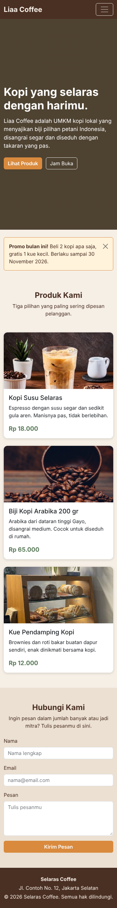
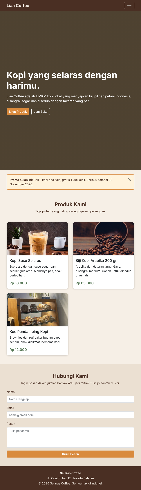
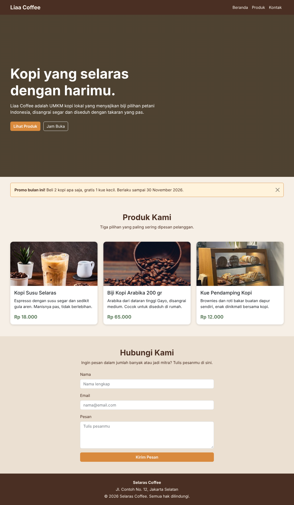

# Website Company Profile Selaras Coffee

Tugas mata kuliah **Desain Web** (Pertemuan 10): membuat website company profile satu halaman untuk UMKM menggunakan Bootstrap 5 dan stylesheet custom.

**Nama:** Ardhelia Salsabila Al-Bahri
**NPM:** 4525210092

---

## 1. Deskripsi

Selaras Coffee adalah UMKM kopi lokal. Website ini dibuat untuk dipresentasikan kepada calon pelanggan dan mitra. Komponen dasarnya memakai Bootstrap, lalu diberi branding sendiri lewat `style.css` supaya tampilannya tetap khas Selaras Coffee.

## 2. Struktur Folder

```
Pertemuan10/
├── index.html
├── style.css
├── images/
│   ├── kopisusu.jpg
│   ├── bijikopi.jpg
│   └── kue.jpg
├── screenshot/
│   ├── hp.png
│   ├── tablet.png
│   └── laptop.png
└── README.md
```

## 3. Komponen yang Digunakan

| Komponen | Keterangan |
|---|---|
| Navbar | Responsif, menjadi menu hamburger di layar kecil |
| Hero | Judul, deskripsi singkat, tombol "Lihat Produk" dan "Jam Buka" |
| Card (3 buah) | Kopi Susu Selaras, Biji Kopi Arabika, Kue Pendamping Kopi |
| Alert | Promo beli 2 kopi gratis 1 kue, bisa ditutup |
| Modal | Informasi jam buka, dibuka dari tombol di hero |
| Form kontak | Nama, email, dan pesan (memakai atribut `required`) |
| Footer | Alamat dan hak cipta |
| Stylesheet custom | `style.css` untuk warna, tombol, card, dan footer |

## 4. Branding

Warna dipilih dari suasana kopi dan disimpan sebagai variabel CSS di `:root`:

| Warna | Kode | Dipakai untuk |
|---|---|---|
| Coklat kopi | `#4a2f23` | Navbar, footer, teks |
| Hijau daun | `#5b7b5a` | Latar hero, harga produk |
| Krem | `#f6efe6` | Latar halaman |
| Oranye | `#d98a3d` | Tombol dan garis alert promo |

Link `style.css` ditaruh setelah link Bootstrap di `<head>`, sehingga aturan CSS buatan sendiri bisa menimpa tampilan bawaan Bootstrap.

## 5. Tampilan pada Tiga Ukuran Layar

Card produk memakai class `col-12 col-md-6 col-lg-4`, sehingga jumlah kolomnya berubah mengikuti ukuran layar.

### HP (lebar 375px)



- Navbar menjadi menu hamburger.
- Card tersusun 1 kolom ke bawah.
- Ukuran judul hero 2,2rem.

### Tablet (lebar 768px)



- Navbar masih berupa menu hamburger.
- Card tersusun 2 kolom.
- Ukuran judul hero 3rem.

### Laptop (lebar 1200px)



- Menu navbar tampil mendatar.
- Card tersusun 3 kolom sejajar.
- Ukuran judul hero 3,5rem.

## 6. Masalah dan Solusi

| No | Masalah | Solusi |
|---|---|---|
| 1 | Bagian atas hero tertutup navbar karena navbar memakai `fixed-top` | Menambah `padding-top: 80px` pada `.hero` |
| 2 | Warna tombol masih biru bawaan Bootstrap | Membuat class sendiri `.btn-tombol` dan memanggil `style.css` setelah Bootstrap |
| 3 | Ikon hamburger tidak terlihat di navbar coklat | Memakai `filter: invert(1)` supaya ikon menjadi putih |
| 4 | Tinggi card tidak sama | Menambah class `h-100` pada card |
| 5 | CSS tidak muncul karena path `css/style.css` salah | Mengubah link menjadi `style.css` karena file berada satu folder dengan `index.html` |
| 6 | Emoji pada card kurang menarik | Mengganti dengan tag `` dan mengatur `object-fit: cover` supaya foto tidak gepeng |
| 7 | Form belum bisa menyimpan pesan | Belum belajar JavaScript/PHP, jadi form hanya tampilan dengan validasi dasar `required` dan `type="email"` |

## 7. Cara Menjalankan

1. Download atau clone folder project ini.
2. Buka `index.html` di browser.
3. Pastikan terhubung ke internet karena Bootstrap dipanggil lewat CDN.

## 8. Teknologi

- HTML5
- CSS3
- Bootstrap 5.3.3 (CDN)
