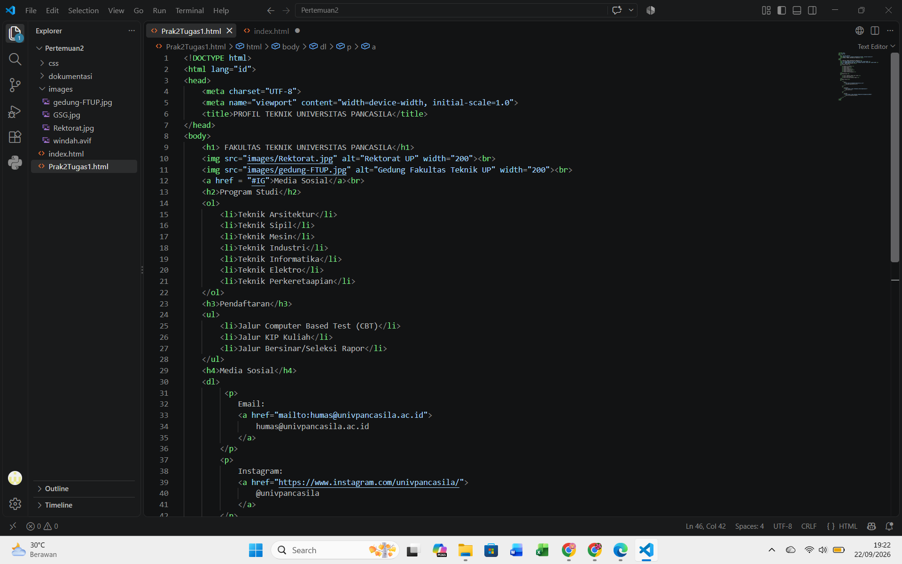
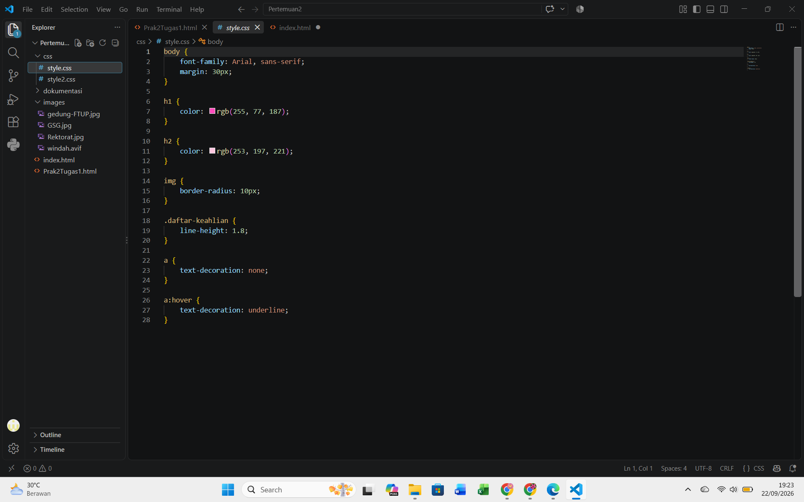
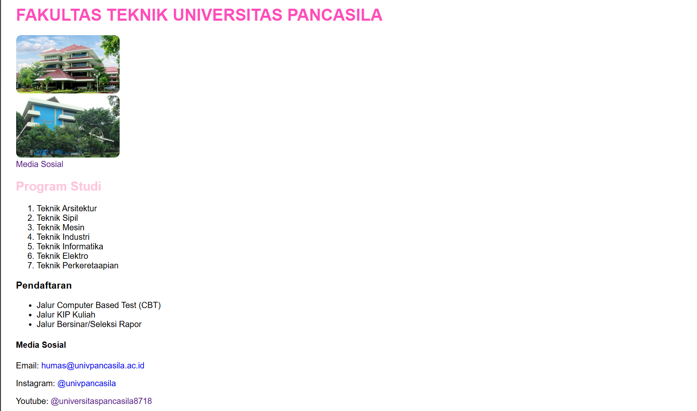

# Praktikum Web – Profil Teknik Universitas Pancasila

## Screenshoot Code

### 1. Kode HTML

Berikut adalah screenshoot kode HTML yang digunakan untuk membuat halaman profil Fakultas Teknik Universitas Pancasila.

### 2. Kode CSS

CSS digunakan untuk mengatur tampilan halaman, seperti jenis huruf, warna judul, jarak halaman, bentuk gambar, dan tampilan tautan.

## Screenshoot Output

Berikut adalah hasil tampilan halaman HTML setelah dijalankan melalui browser.

## Ringkasan

Pada praktikum ini dilakukan pembuatan halaman web sederhana yang menampilkan profil Fakultas Teknik Universitas Pancasila menggunakan HTML dan CSS. Perubahan utama dilakukan pada struktur HTML dengan menampilkan judul fakultas, gambar gedung, daftar program studi, informasi pendaftaran, serta media sosial berupa email, Instagram, dan YouTube. CSS kemudian digunakan untuk memperbaiki tampilan halaman, terutama jenis font, jarak halaman, warna judul, bentuk sudut gambar, dan efek pada tautan. Masalah yang ditemukan adalah beberapa bagian seperti “Pendaftaran” dan “Media Sosial” tidak berubah warna meskipun aturan CSS sudah dibuat. Setelah diperiksa, penyebabnya adalah file CSS belum terhubung dengan dokumen HTML melalui elemen `<link rel="stylesheet" href="css/style.css">` pada bagian `<head>`. Selain itu, setiap elemen HTML harus menggunakan selector CSS yang sesuai, misalnya `h3` untuk Pendaftaran dan `h4` untuk Media Sosial. Solusinya adalah menghubungkan file `style.css` dengan HTML dan menambahkan aturan CSS untuk elemen tersebut. Setelah file disimpan dan halaman di-refresh, perubahan tampilan dapat diterapkan dengan benar. Hasil akhirnya adalah halaman profil yang lebih terstruktur, rapi, dan memiliki warna sesuai rancangan.
