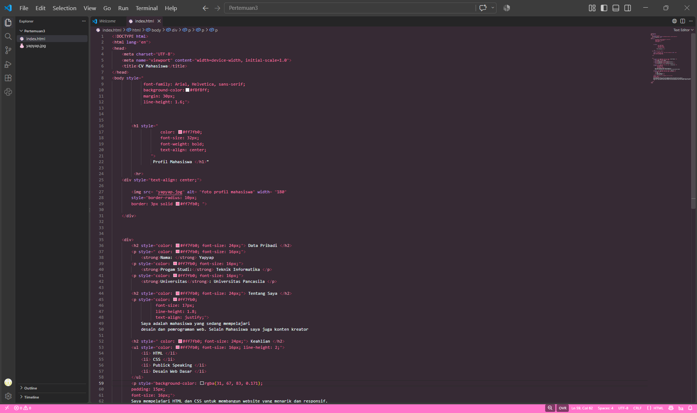
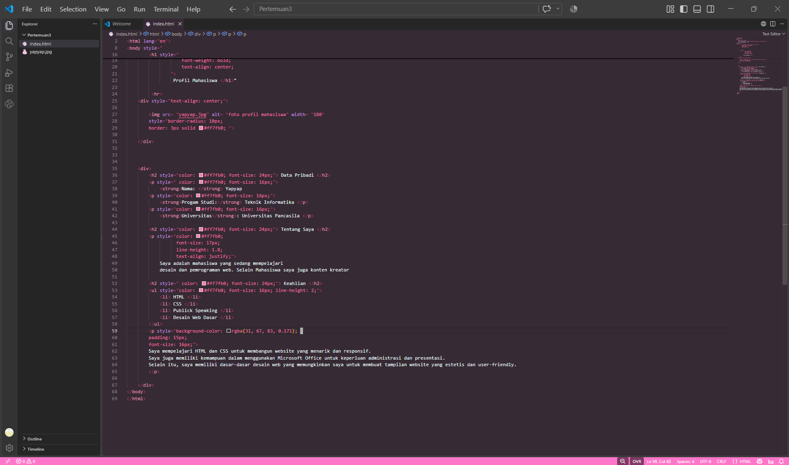
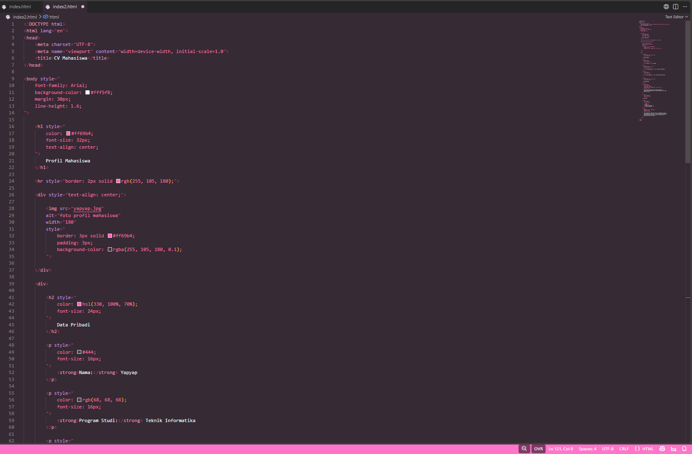
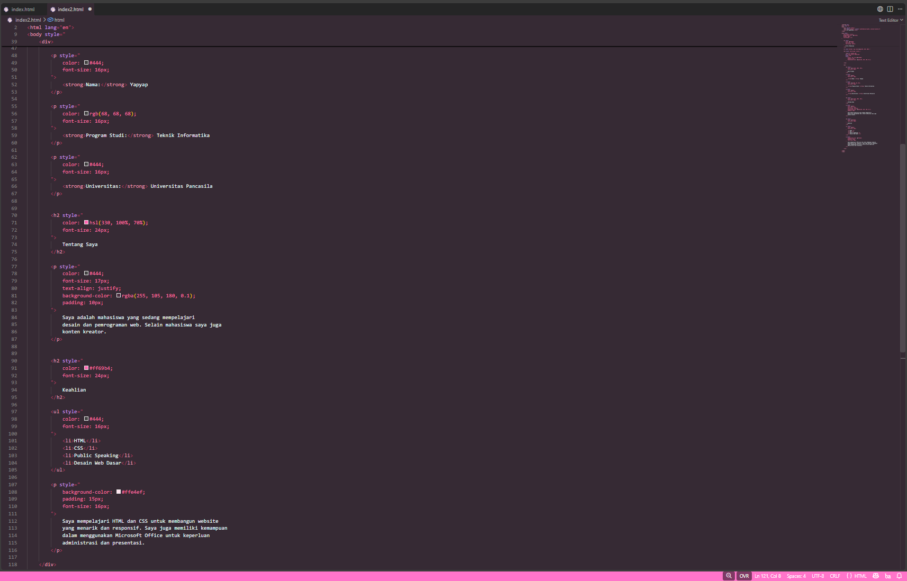

# Tugas Praktikum Pertemuan 3

## Tugas Individu

Modifikasi profil mahasiswa pada HTML menggunakan minimal 10 property CSS Inline dan 4 format warna yang berbeda.

## 1. Deskripsi

Pada tugas ini saya melakukan perubahan sederhana pada halaman profil mahasiswa menggunakan CSS Inline. Perubahan dilakukan langsung pada atribut `style` di dalam HTML tanpa membuat file CSS terpisah.

Tujuan perubahan adalah membuat tampilan profil sedikit lebih rapi dan menarik, terutama pada warna, ukuran teks, foto, dan bagian paragraf.

## 2. Perubahan yang Dilakukan

Beberapa perubahan yang dilakukan:

1. Mengubah warna background halaman.
2. Mengubah warna dan ukuran judul.
3. Mengubah warna garis `
`.
4. Menambahkan border pada foto.
5. Menambahkan padding pada foto.
6. Mengubah warna heading bagian.
7. Mengatur ukuran font pada teks.
8. Mengatur warna teks.
9. Menambahkan background pada bagian "Tentang Saya".
10. Menambahkan padding pada paragraf.
11. Mengatur `text-align` pada beberapa bagian.
12. Mengatur `line-height` pada halaman dan teks.

## 3. CSS Inline yang Digunakan

Property CSS yang digunakan lebih dari 10, di antaranya:

- `font-family`
- `background-color`
- `margin`
- `line-height`
- `color`
- `font-size`
- `text-align`
- `border`
- `padding`

Semua property tersebut ditulis langsung pada atribut `style`, sehingga tidak menggunakan file CSS terpisah.

## 4. Format Warna

Dalam kode digunakan 4 format warna yang berbeda:

| Format | Contoh |
|---|---|
| HEX | `#ff69b4` |
| RGB | `rgb(255, 105, 180)` |
| RGBA | `rgba(255, 105, 180, 0.1)` |
| HSL | `hsl(330, 100%, 70%)` |

## 5. Dokumentasi Sebelum

Berikut adalah screenshot kode sebelum dilakukan perubahan.

### Screenshot Sebelum 1

### Screenshot Sebelum 2

## 6. Dokumentasi Sesudah

Berikut adalah screenshot kode setelah dilakukan perubahan.

### Screenshot Sesudah 1

### Screenshot Sesudah 2

## 7. Masalah dan Solusi

**Masalah:**
Tampilan awal masih sederhana dan sebagian besar menggunakan warna serta pengaturan CSS yang sama.

**Solusi:**
Saya menambahkan beberapa CSS Inline untuk mengatur warna, ukuran teks, jarak, border, dan background agar tampilan lebih rapi tanpa membuat file CSS baru.

## 8. Kesimpulan

Dari praktikum ini saya memahami cara menggunakan CSS Inline untuk melakukan perubahan tampilan pada HTML. Saya juga memahami penggunaan beberapa property CSS serta perbedaan format warna HEX, RGB, RGBA, dan HSL.
