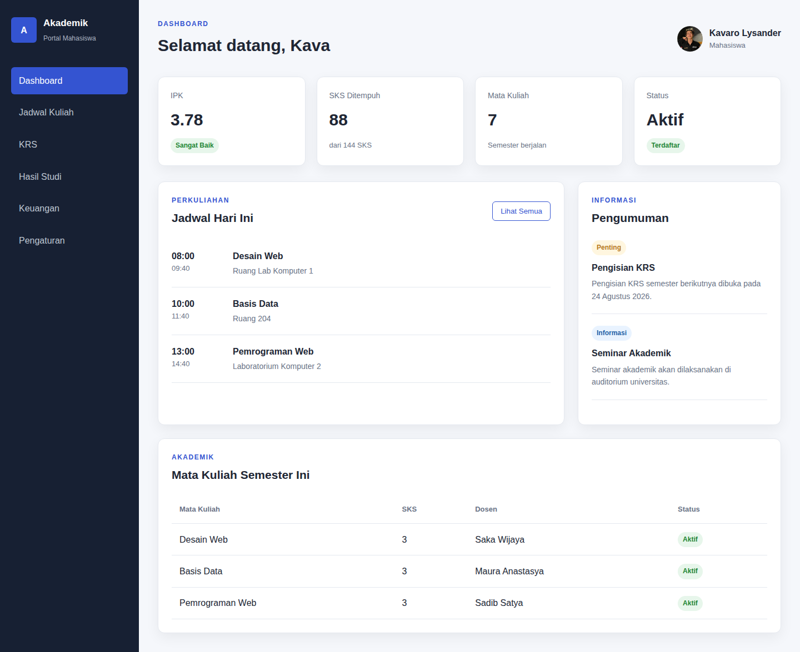
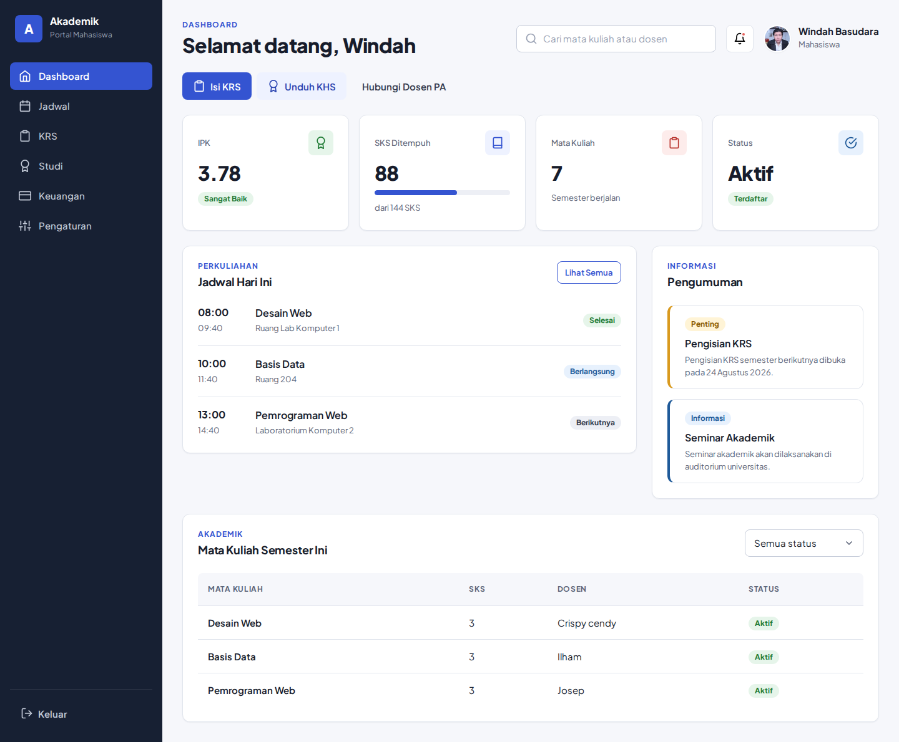
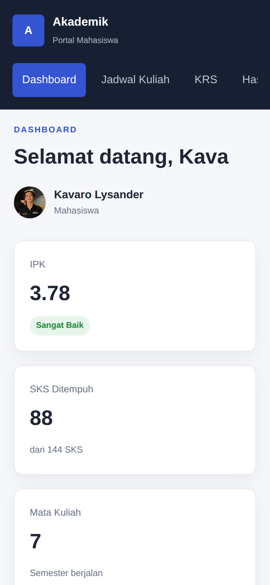
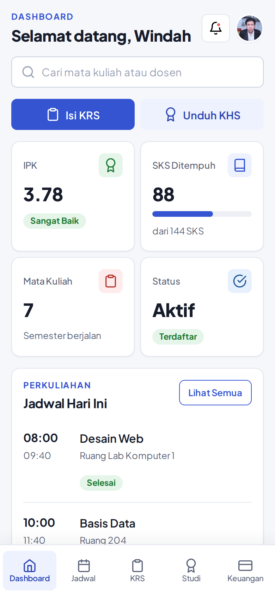
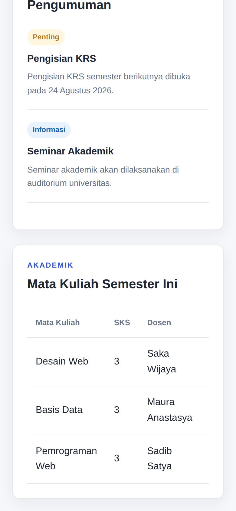
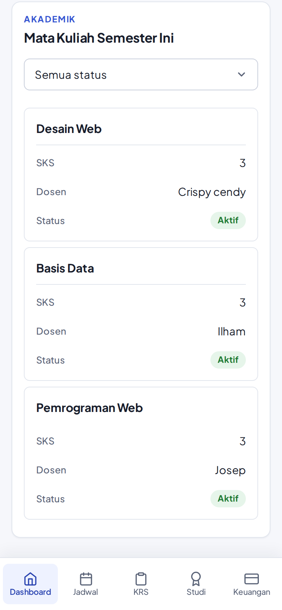
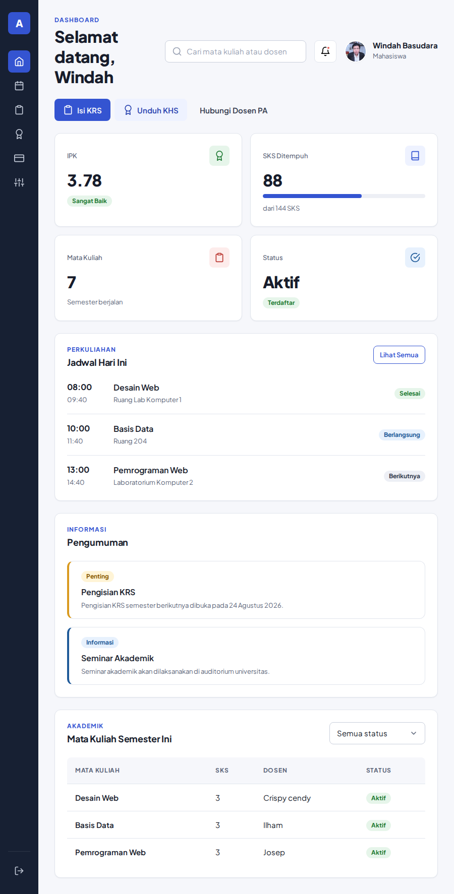

# Tugas Praktikum — Simple Design System "Akademik UI"

Tugas Individu: membuat Simple Design System (colors, typography, spacing, buttons, form controls, cards), lalu menerapkannya pada Mockup Contoh 2 (Dashboard Mahasiswa, Pertemuan 6) dengan Color Palette, Type Scale, Button Style, Card Style, dan tampilan mobile.

## 1. Design System "Akademik UI"
| Bagian | Isi |
|---|---|
| Color | Primary `#3454D1` (hover `#2A44B0`, active `#213689`) · Accent `#E5605A` · Neutral `#171C2B` → `#FFFFFF` · Success `#1E7A33` · Warning `#8A5A00` · Info `#1F5A99` · Danger `#C23B35` |
| Typography | Plus Jakarta Sans · H1 32/40 ExtraBold · H2 24/32 Bold · H3 18/26 Bold · H4 16/24 SemiBold · Body 15/24 · Small 13/20 · Eyebrow 12/16 Uppercase |
| Spacing | XS 4 · S 8 · M 16 · L 24 · XL 32 · XXL 48 (px); radius 8/12/16; shadow S, M, L |
| Buttons | Primary, Secondary, Outline, Ghost, Danger · ukuran 36/44/52px · state default, hover, active, focus, disabled |
| Form controls | Input, input + ikon, select, textarea, checkbox, radio · state default, hover, focus, error, disabled |
| Cards | Card dasar, statistik (ikon + progress), pengumuman (aksen kiri), interaktif (hover) + badge status |

Urutan file CSS: `tokens.css` → `components.css` → `dashboard.css`. Dokumentasi lengkap ada di `design-system.html` (`screenshots/design-system.png`).

## 2. Screenshot sebelum & sesudah

**Desktop (1440px)**

Sebelum: 

Sesudah: 

**Mobile (390px)**

| Sebelum (atas) | Sesudah (atas) |
|---|---|
|  |  |

| Sebelum (bawah) | Sesudah (bawah) |
|---|---|
|  |  |

**Tablet (900px), sesudah:** 

## 3. Perubahan, masalah, dan solusi
| No | Bagian | Masalah pada Contoh 2 | Solusi / perubahan |
|---|---|---|---|
| 1 | Struktur folder & path CSS | HTML memanggil `css/style.css`, tetapi folder asli bernama `CSS`. Di Windows tetap jalan, di Linux/hosting yang membedakan huruf besar-kecil halaman tampil tanpa gaya. | Folder diganti `css` dan dipecah menjadi `tokens.css`, `components.css`, `dashboard.css`, `docs.css`. |
| 2 | File & alt gambar profil | Foto berekstensi `.jpe` yang jarang dikenali server; alt text "Keonho" tidak sesuai nama pengguna. | Diganti `profile.jpg`, alt "Foto profil Kavaro Lysander". |
| 3 | Color Palette | Warna ditulis langsung di luar variabel (`#172033`, `#bec6d2`, `#aeb6c4`); hanya satu warna utama tanpa skala; kontras badge Success 4.14:1 dan Warning 3.38:1 (di bawah 4.5:1). | Palet lengkap Primary 50–700, Accent, Neutral, Navy, 4 warna semantik. Teks badge digelapkan: Success 4.79:1, Warning 5.41:1. |
| 4 | Type Scale | Font Arial tanpa skala; ukuran acak (12, 13, 14, 16, 17, 21, 30px). | Plus Jakarta Sans (lokal), skala 7 tingkat dengan tinggi baris, kelas `.h1`–`.h4`, `.body`, `.small`, `.eyebrow`. |
| 5 | Spacing | Token `--space-1`…`--space-5` dibuat tetapi tidak dipakai; padding acak (14, 17, 22, 28, 34px). | Token `--space-xs`…`--space-xxl` (kelipatan 4px) dipakai di semua komponen; ditambah token radius & shadow. |
| 6 | Button Style | Hanya satu gaya (`.btn-outline`) tanpa state focus/active/disabled; tinggi ±36px. | 5 varian, 3 ukuran, semua state, tinggi minimum 44px. Dipakai pada Isi KRS, Unduh KHS, Lihat Semua, Keluar. |
| 7 | Form Controls | Tidak ada form control sama sekali. | Input, input + ikon, select, checkbox, radio, state error/disabled. Diterapkan pada pencarian topbar dan filter status tabel. |
| 8 | Card Style | Kartu statistik, panel, notifikasi bergaya berbeda-beda; kartu statistik hanya teks. | Satu `.card` dasar dengan varian stat (ikon + progress SKS 88/144), notice (garis warna), interactive (hover). |
| 9 | Struktur HTML & aksesibilitas | `<h2>` untuk merek di sidebar mengacaukan hierarki judul; jadwal berupa `
`; menu aktif hanya kelas; input tanpa label; `th` tanpa scope. | Jadwal `<ul>`, kartu `<article>`, `<nav aria-label>` + `aria-current="page"`, label di setiap input, `th scope="col"`, `role="progressbar"`. |
| 10 | Fokus keyboard | Tidak ada tanda fokus pada tautan/tombol. | Focus ring 3px dari token `--focus-ring`. |
| 11 | Sidebar desktop | Ikut bergulir dan menu hanya teks. | Sticky setinggi layar, ikon SVG, tombol Keluar; ≤1100px mengecil menjadi mode ikon. |
| 12 | Tampilan mobile | Sidebar menumpuk di atas sebagai deretan menu geser; tabel hanya bisa digeser ke samping. | Bottom navigation 5 item, topbar dirapikan, tombol aksi berdampingan, tabel menjadi kartu per mata kuliah (`data-label`). |
| 13 | Konten dashboard | Jadwal tanpa status; tidak ada aksi cepat. | Badge status jadwal (Selesai, Berlangsung, Berikutnya) dan aksi cepat Isi KRS / Unduh KHS. |
| 14 | Dokumentasi | Tidak ada acuan tertulis. | Halaman `design-system.html` berisi semua token, contoh komponen, dan aturan pemakaian. |
