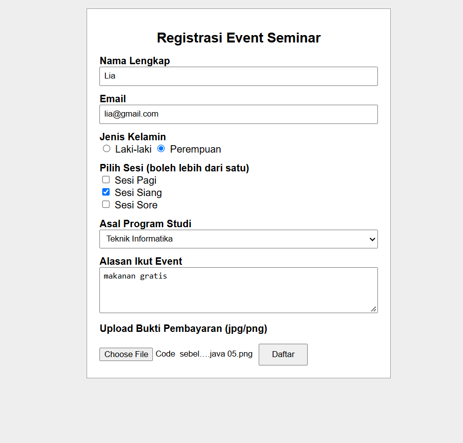

# Form Registrasi Event Seminar

Tugas Praktikum Individu

**Nama:** Ardhelia Salsabila Al-Bahri
**NPM:** 4525210092
**Kampus:** Universitas Pancasila

## Deskripsi

Ini adalah form registrasi event seminar yang dibuat dengan HTML dan CSS saja (tanpa JavaScript). Validasi form memakai atribut bawaan HTML5, jadi pesan error ditampilkan langsung oleh browser.

## Isi Folder

```
form-event/
├── index.html   -> halaman form registrasi
├── style.css    -> tampilan form
└── README.md    -> penjelasan project
```

## Cara Menjalankan

1. Download atau salin folder `form-event`.
2. Buka file `index.html` dengan browser (Chrome, Firefox, atau Edge).
3. Isi form lalu klik tombol **Daftar**.

Catatan: `action="proses.php"` pada form mengarah ke file yang belum dibuat. Jadi kalau semua isian sudah benar dan tombol Daftar diklik, browser akan menuju `proses.php` (halaman belum tersedia). Yang diuji di tugas ini adalah validasi sebelum form terkirim.

## Isi Form

| Field | Jenis input |
|---|---|
| Nama Lengkap | text |
| Email | email |
| Jenis Kelamin | radio |
| Pilih Sesi | checkbox |
| Asal Program Studi | select |
| Alasan Ikut Event | textarea |
| Bukti Pembayaran | upload file |

## Aturan Validasi

1. Nama, email, jenis kelamin, prodi, alasan, dan upload wajib diisi (`required`).
2. Nama minimal 3 karakter dan hanya boleh huruf dan spasi (`minlength` dan `pattern`).
3. Email harus berformat email, misalnya ada tanda `@` (`type="email"`).
4. Alasan minimal 10 karakter (`minlength`).
5. File upload dibatasi jpg dan png (`accept`).

## Test Case Validasi (Skenario Input Salah)

| No | Field | Input uji | Hasil yang diharapkan | Hasil aktual |
|---|---|---|---|---|
| 1 | Nama | (dikosongkan) | Form tidak terkirim, muncul pesan field wajib diisi | (isi setelah diuji) |
| 2 | Nama | `Budi123` | Form tidak terkirim, muncul pesan "Nama hanya boleh huruf dan spasi" | (isi setelah diuji) |
| 3 | Email | `budigmail.com` | Form tidak terkirim, muncul pesan email harus memakai `@` | (isi setelah diuji) |
| 4 | Prodi | Tidak memilih | Form tidak terkirim, muncul pesan agar memilih salah satu item | (isi setelah diuji) |
| 5 | Alasan | `bagus` | Form tidak terkirim, muncul pesan teks minimal 10 karakter | (isi setelah diuji) |
| 6 | Jenis kelamin | Tidak memilih | Form tidak terkirim, muncul pesan agar memilih salah satu opsi | (isi setelah diuji) |
| 7 | Upload | Tidak memilih file | Form tidak terkirim, muncul pesan agar memilih file | (isi setelah diuji) |

## Validasi yang Tetap Wajib di Server

Validasi HTML hanya membantu pengguna. Pengguna masih bisa melewatinya lewat Inspect Element atau Postman, jadi server harus mengecek ulang:

- Semua field wajib dan formatnya (nama, email, alasan, dll).
- Checkbox minimal 1 sesi, karena HTML tidak bisa mewajibkan ini.
- Ukuran file, karena HTML tidak bisa membatasi ukuran.
- Tipe file yang sebenarnya, karena `accept` mudah dilewati dan nama file bisa dipalsukan.
- Nilai radio dan select harus sesuai pilihan yang tersedia.
- Email tidak boleh sudah terdaftar (butuh database).
- Data dibersihkan sebelum disimpan atau ditampilkan (mencegah XSS dan SQL injection).

## Perubahan, Masalah, dan Solusi

| Masalah | Solusi |
|---|---|
| Tidak boleh memakai JavaScript | Validasi memakai atribut HTML5 (`required`, `pattern`, `minlength`, `type="email"`, `accept`) |
| Checkbox tidak bisa diwajibkan minimal satu lewat HTML | Dicatat sebagai validasi yang harus dilakukan di server |
| Ukuran file tidak bisa dibatasi lewat HTML | Dicatat sebagai validasi yang harus dilakukan di server |
| Pesan error tidak bisa diatur sendiri | Memakai pesan bawaan browser, khusus nama dibuat lebih jelas dengan atribut `title` |

## Screenshot
