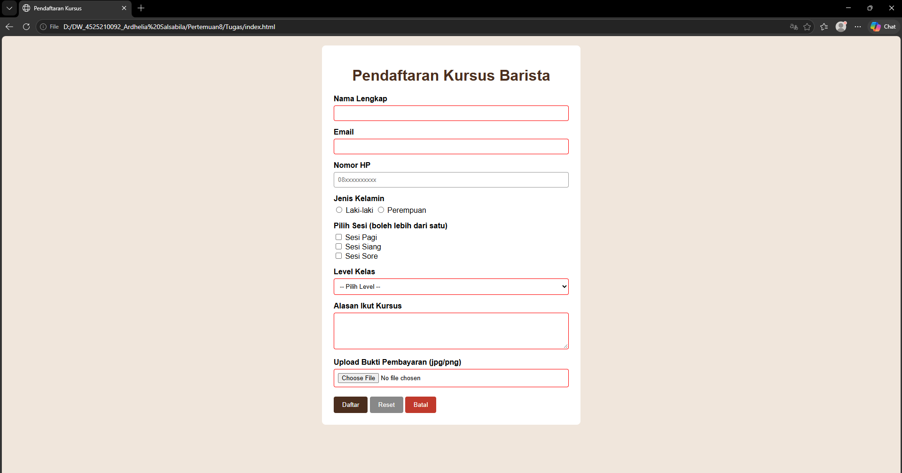
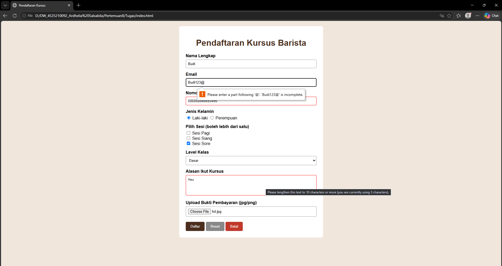
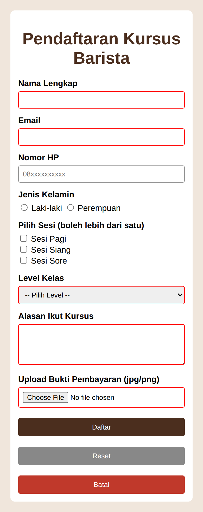
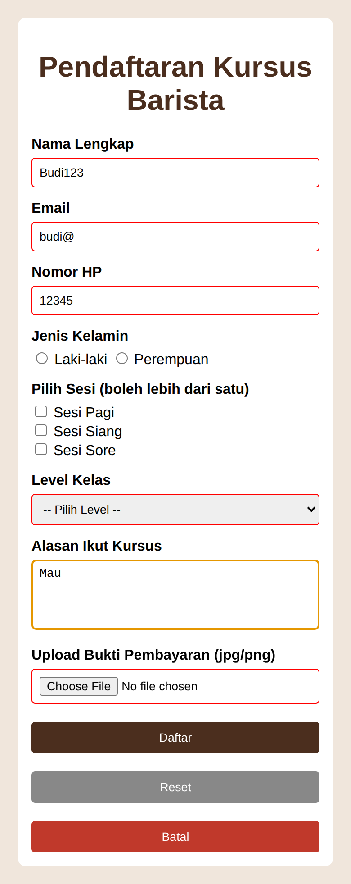

# Tugas Praktikum – Form Pendaftaran Kursus Barista

## 1. Deskripsi Proyek

Project ini merupakan tugas praktikum Pemrograman Web berupa pembuatan **Form Pendaftaran Kursus Barista** menggunakan HTML dan CSS. Form menyediakan input data peserta, pilihan jenis kelamin, pilihan sesi, level kelas, alasan mengikuti kursus, serta unggah bukti pembayaran.

Project ini juga menerapkan validasi input HTML5 untuk membantu pengguna mengisi data sesuai ketentuan.

## 2. Tujuan Praktikum

- Memahami penggunaan elemen form pada HTML.
- Menggunakan radio button, checkbox, select, textarea, dan input file.
- Menerapkan tiga jenis button: submit, reset, dan button.
- Menerapkan validasi input menggunakan atribut HTML5.
- Menguji form dengan beberapa skenario input yang salah.
- Memahami validasi yang tetap harus dilakukan pada sisi server.

## 3. Fitur Form

| Elemen | Fungsi |
|---|---|
| Nama lengkap | Mengisi nama peserta |
| Email | Mengisi alamat email |
| Nomor HP | Mengisi nomor telepon |
| Radio button | Memilih jenis kelamin |
| Checkbox | Memilih sesi kursus |
| Select | Memilih level kelas |
| Textarea | Menuliskan alasan mengikuti kursus |
| Upload file | Mengunggah bukti pembayaran |
| Tombol Daftar | Mengirim form (submit) |
| Tombol Reset | Mengosongkan kembali isian form |
| Tombol Batal | Tombol bertipe `button` |

## 4. Aturan Validasi pada Source Code

Validasi berikut ditemukan pada `Tugas/index.html`:

1. **Nama lengkap**
   - Wajib diisi (`required`).
   - Panjang 3–50 karakter (`minlength` dan `maxlength`).
   - Hanya boleh berisi huruf dan spasi (`pattern="[A-Za-z ]+"`).

2. **Email**
   - Wajib diisi.
   - Menggunakan tipe `email` agar browser memeriksa format dasar alamat email.

3. **Nomor HP**
   - Wajib diisi.
   - Harus diawali `08` dan diikuti 8–11 angka (`pattern="08[0-9]{8,11}"`).

4. **Jenis kelamin**
   - Salah satu pilihan radio wajib dipilih (`required`).

5. **Sesi kursus**
   - Disediakan pilihan menggunakan checkbox.
   - Pada source code saat ini, pilihan sesi tidak diberi atribut `required`.

6. **Level kelas**
   - Wajib memilih opsi pada elemen `select` (`required`).

7. **Alasan mengikuti kursus**
   - Wajib diisi.
   - Panjang 10–200 karakter.

8. **Bukti pembayaran**
   - Wajib mengunggah file.
   - Atribut `accept` membatasi pilihan file pada browser ke `.jpg`, `.jpeg`, dan `.png`.

> Catatan: atribut `accept` hanya membantu membatasi pilihan file pada antarmuka browser. Atribut ini bukan pemeriksaan keamanan file.

## 5. Skenario Pengujian (Test Case)

Gunakan tabel berikut untuk mencatat hasil pengujian langsung di browser. Kolom hasil aktual sengaja disediakan untuk diisi berdasarkan hasil pengujian sebenarnya.

| No. | Field | Input / Kondisi Salah | Hasil yang Diharapkan | Hasil Aktual |
|---:|---|---|---|---|
| 1 | Nama lengkap | Kosong | Form ditolak karena field wajib diisi | Isi setelah pengujian |
| 2 | Nama lengkap | Kurang dari 3 karakter | Form ditolak karena tidak memenuhi panjang minimum | Isi setelah pengujian |
| 3 | Nama lengkap | Mengandung angka atau simbol | Form ditolak karena tidak sesuai pola | Isi setelah pengujian |
| 4 | Email | Format email tidak valid | Form ditolak oleh validasi tipe email browser | Isi setelah pengujian |
| 5 | Nomor HP | Tidak diawali `08` | Form ditolak karena tidak sesuai pola | Isi setelah pengujian |
| 6 | Nomor HP | Mengandung huruf atau jumlah digit tidak sesuai | Form ditolak karena tidak sesuai pola | Isi setelah pengujian |
| 7 | Jenis kelamin | Tidak memilih opsi | Form ditolak karena pilihan wajib diisi | Isi setelah pengujian |
| 8 | Level kelas | Tidak memilih opsi yang valid | Form ditolak jika nilai awal select merupakan placeholder kosong | Isi setelah pengujian |
| 9 | Alasan kursus | Kurang dari 10 karakter | Form ditolak karena tidak memenuhi panjang minimum | Isi setelah pengujian |
| 10 | Bukti pembayaran | Tidak mengunggah file | Form ditolak karena file wajib diunggah | Isi setelah pengujian |

## 6. Bukti Screenshot

Bukti tampilan dan pengujian tersedia di folder `image/`:

-  – Tampilan form kosong pada desktop.
-  – Tampilan form dengan input salah pada desktop.
-  – Tampilan form kosong pada perangkat mobile.
-  – Tampilan form dengan input salah pada perangkat mobile.

## 7. Struktur Folder

```text
Pertemuan8/
├── image/
│   ├── dekstop-kosong.png
│   ├── desktop-inputsalah.png
│   ├── mobile-inputsalah.png
│   └── mobile-kosong.png
├── Quis/
│   ├── index.html
│   └── style.css
├── Tugas/
│   ├── index.html
│   └── style.css
└── README.md
```

Keterangan:
- `image/` berisi screenshot.
- `Quis/` berisi source code latihan kuis.
- `Tugas/` berisi source code utama form pendaftaran kursus barista.
- `index.html` berisi struktur halaman dan form.
- `style.css` mengatur tampilan halaman.

## 8. Cara Menjalankan Project

1. Ekstrak file `Pertemuan8.zip`.
2. Buka folder `Pertemuan8/Tugas`.
3. Jalankan file `index.html` menggunakan browser (Google Chrome, Microsoft Edge, atau Mozilla Firefox).
4. Isi form dan coba beberapa skenario input salah.
5. Periksa pesan validasi yang ditampilkan browser.
6. Uji tombol Reset untuk mengosongkan isian form.

## 9. Validasi yang Tetap Wajib Dilakukan di Server

Validasi HTML5 berjalan di sisi client (browser) dan dapat dilewati, misalnya dengan menonaktifkan JavaScript, mengubah request, atau mengirim data langsung ke server. Karena itu, server tetap harus memvalidasi ulang data yang diterima.

Validasi server-side yang diperlukan antara lain:

- Memastikan semua field wajib benar-benar terisi.
- Memeriksa kembali format, panjang, dan karakter nama, email, serta nomor HP.
- Memastikan nilai jenis kelamin, sesi, dan level termasuk pilihan yang diizinkan.
- Memeriksa panjang alasan mengikuti kursus.
- Memvalidasi unggahan berdasarkan isi/MIME file, ekstensi, dan ukuran; jangan hanya mengandalkan nama file atau atribut `accept`.
- Mengganti nama file di server, menyimpan di lokasi yang aman, dan mencegah file berbahaya dieksekusi.
- Memproses data pendaftaran dan pembayaran secara aman.

**Kesimpulan:** validasi client-side membantu pengguna memperbaiki kesalahan sebelum mengirim form, sedangkan validasi server-side wajib menjaga keamanan dan keakuratan data yang diterima aplikasi.

## 10. Kesimpulan Praktikum

Melalui praktikum ini, mahasiswa mempraktikkan penggunaan berbagai elemen form HTML, pengaturan tampilan dengan CSS, dan validasi input menggunakan atribut HTML5 seperti `required`, `minlength`, `maxlength`, `pattern`, serta `accept`.

Praktikum ini juga menunjukkan bahwa validasi pada browser tidak cukup untuk melindungi aplikasi. Data tetap harus diperiksa kembali di server sebelum disimpan atau diproses.
