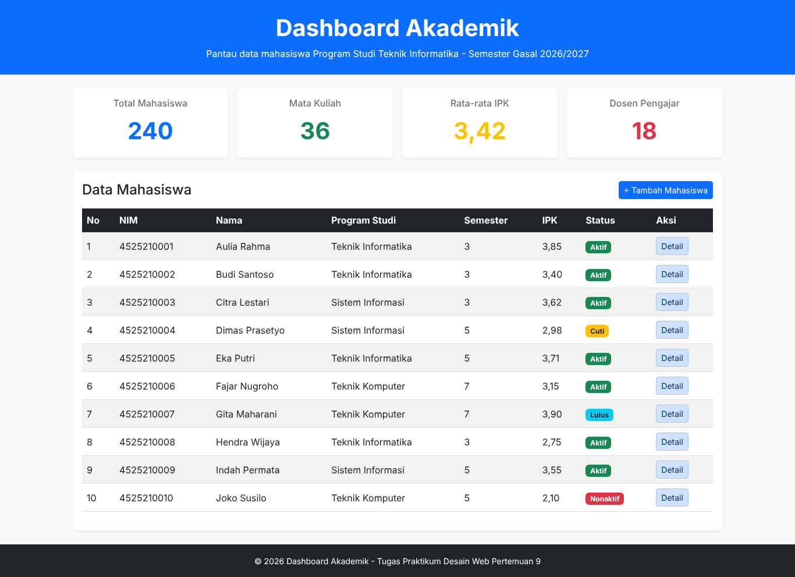
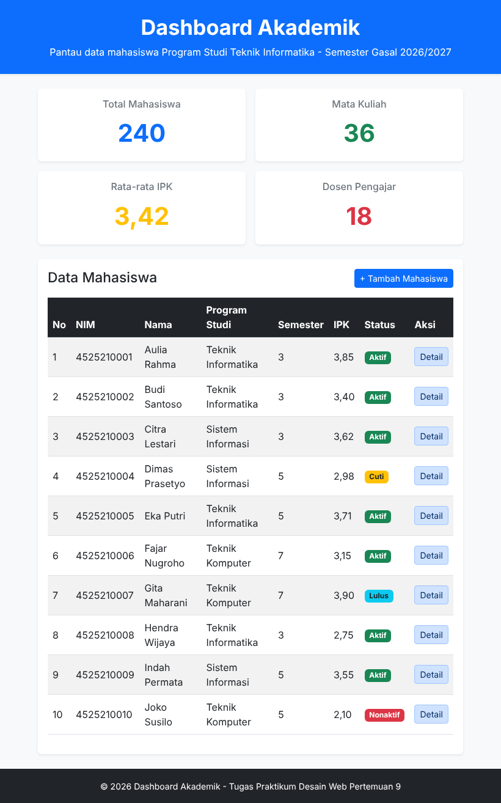
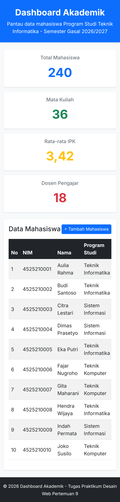

# Dashboard Akademik

Tugas Praktikum Desain Web — Pertemuan 9

Halaman dashboard sederhana untuk memantau data mahasiswa Program Studi Teknik Informatika pada Semester Gasal 2026/2027. Halaman dibuat dengan HTML dan **Bootstrap 5** serta sedikit CSS buatan sendiri, dan tampilannya responsif di HP, tablet, maupun laptop.

## Identitas

| | |
|---|---|
| Nama | Ardhelia |
| NPM | 4525210092 |
| Mata Kuliah | Desain Web (Praktikum) |
| Semester | Gasal 2026/2027 |

## Struktur Folder

```
Pertemuan9/
├── README.md        # Dokumentasi proyek
├── images/          # Screenshot hasil tampilan responsif
│   ├── laptop.png
│   ├── tablet.png
│   └── hp.png
└── Tugas/
    ├── index.html   # Halaman utama (struktur & isi dashboard)
    └── style.css    # CSS buatan sendiri (dimuat setelah Bootstrap)
```

## Fitur dan Komponen

### 1. Header
Judul "Dashboard Akademik" dengan subjudul program studi dan semester, menggunakan latar `bg-primary` dan teks putih.

### 2. Empat Kartu Statistik
Menampilkan ringkasan data dalam bentuk kartu (`card`):

| Kartu | Nilai | Warna |
|---|---|---|
| Total Mahasiswa | 240 | Biru (`text-primary`) |
| Mata Kuliah | 36 | Hijau (`text-success`) |
| Rata-rata IPK | 3,42 | Kuning (`text-warning`) |
| Dosen Pengajar | 18 | Merah (`text-danger`) |

Tata letak kartu memakai grid Bootstrap sehingga jumlah kolomnya menyesuaikan lebar layar:

| Perangkat | Kelas | Jumlah Kolom |
|---|---|---|
| HP | `col-12` | 1 kolom |
| Tablet | `col-md-6` | 2 kolom |
| Laptop | `col-lg-3` | 4 kolom |

### 3. Tabel Data Mahasiswa
Tabel berisi 10 data mahasiswa dengan kolom **No, NIM, Nama, Program Studi, Semester, IPK, Status, dan Aksi**.

- `table-striped` dan `table-hover` untuk baris belang dan efek sorot saat kursor lewat.
- `table-responsive` agar tabel bisa digeser ke samping pada layar kecil.
- Kolom **Status** memakai *badge* berwarna:
  - 🟢 **Aktif** (`bg-success`)
  - 🟡 **Cuti** (`bg-warning`)
  - 🔵 **Lulus** (`bg-info`)
  - 🔴 **Nonaktif** (`bg-danger`)
- Tombol **+ Tambah Mahasiswa** dan **Detail** pada tiap baris (saat ini hanya tampilan, belum memiliki fungsi).

### 4. Footer
Keterangan hak cipta dan identitas tugas dengan latar `bg-dark`.

## CSS Buatan Sendiri (`style.css`)

| Selector | Fungsi |
|---|---|
| `.angka` | Mengatur angka pada kartu statistik (ukuran `2.5rem`, tebal, tanpa margin bawah) |
| `.card` | Menghilangkan garis tepi bawaan kartu Bootstrap |
| `.card:hover` | Kartu naik sedikit (`translateY(-3px)`) dengan transisi 0,2 detik saat disorot kursor |

## Hasil Tampilan Responsif

Screenshot berikut menunjukkan perubahan layout kartu statistik pada tiga ukuran layar (1 → 2 → 4 kolom).

### Laptop (≥ 992 px) — 4 kolom



Kartu memakai `col-lg-3`, sehingga keempat kartu berjajar dalam satu baris. Tabel tampil penuh tanpa perlu digeser.

### Tablet (768–991 px) — 2 kolom



Kartu memakai `col-md-6`, sehingga tersusun 2 × 2.

### HP (< 768 px) — 1 kolom



Kartu memakai `col-12`, sehingga tersusun ke bawah satu per satu. Tabel dapat digeser ke samping berkat `table-responsive`.

## Fungsi Container, Row, dan Column

| Elemen | Kelas pada halaman | Fungsi |
|---|---|---|
| **Container** | `container` pada `<main>` dan pada isi header | Pembungkus utama yang memusatkan konten dan membatasi lebar maksimumnya sesuai breakpoint, serta memberi *padding* kiri-kanan. |
| **Row** | `row g-3` pada baris kartu statistik | Wadah horizontal untuk kolom. Kolom hanya bekerja dengan benar di dalam row. `g-3` memberi jarak (*gutter*) antarkolom. |
| **Column** | `col-12 col-md-6 col-lg-3` pada tiap kartu | Membagi lebar row menjadi 12 bagian grid. Jumlah bagian yang dipakai berubah mengikuti breakpoint: 12/12 (1 kolom) → 6/12 (2 kolom) → 3/12 (4 kolom). |

Susunan pada halaman ini:

```
container
└── row g-3
    ├── col-12 col-md-6 col-lg-3  →  card "Total Mahasiswa"
    ├── col-12 col-md-6 col-lg-3  →  card "Mata Kuliah"
    ├── col-12 col-md-6 col-lg-3  →  card "Rata-rata IPK"
    └── col-12 col-md-6 col-lg-3  →  card "Dosen Pengajar"
```

## Perubahan, Masalah, dan Solusi

| Perubahan | Masalah | Solusi |
|---|---|---|
| Kartu statistik diberi `col-12 col-md-6 col-lg-3` | Kartu bertumpuk atau terlalu sempit jika layout tidak menyesuaikan ukuran layar | Memakai grid system dan breakpoint Bootstrap agar kartu berubah 1 → 2 → 4 kolom |
| Kartu diberi `h-100` | Tinggi kartu bisa tidak sama dalam satu baris | `h-100` membuat semua kartu dalam satu baris setinggi kartu tertinggi |
| Tabel dibungkus `table-responsive` | Tabel dengan 8 kolom melebihi lebar layar HP dan membuat halaman bisa digeser ke samping | Tabel mendapat scroll horizontal sendiri sehingga halaman tidak melebar |
| `table-striped` dan `table-hover` | Baris tabel sulit dibaca karena tampak seragam | Baris belang-belang dan menyorot baris yang dilewati kursor |
| Badge `Cuti` dan `Lulus` diberi `text-dark` | Teks putih pada latar kuning (`bg-warning`) dan biru muda (`bg-info`) kurang terbaca | Teks diganti gelap agar kontras |
| `style.css` dipanggil setelah Bootstrap | CSS sendiri bisa tertimpa Bootstrap jika dipanggil lebih dulu | Urutan dibalik sehingga `.angka` dan `.card` menimpa aturan bawaan Bootstrap |
| Meta tag `viewport` ditambahkan di `<head>` | Tanpa tag ini, browser HP menampilkan halaman seperti layar desktop yang diperkecil, sehingga breakpoint tidak bekerja | Menambahkan `width=device-width, initial-scale=1` |

## Teknologi

- HTML5
- CSS3
- [Bootstrap 5.3.3](https://getbootstrap.com/) (dimuat lewat CDN jsDelivr)
  - CSS dipanggil di `<head>`
  - JavaScript (bundle) dipanggil di bagian bawah `<body>`

## Cara Menjalankan

1. Ekstrak `Tugas.zip` sehingga folder `Tugas/` muncul.
2. Buka file `index.html` dengan browser (Chrome, Firefox, Edge, dll.).
3. Pastikan perangkat **terhubung ke internet**, karena Bootstrap dimuat lewat CDN.

Untuk mencoba tampilan responsif, ubah ukuran jendela browser atau gunakan mode *Device Toolbar* di DevTools (tekan `F12`, lalu `Ctrl + Shift + M`).

## Catatan

- Data pada dashboard bersifat statis (ditulis langsung di HTML) sebagai contoh.
- Tombol **Tambah Mahasiswa** dan **Detail** belum terhubung ke fitur apa pun.
